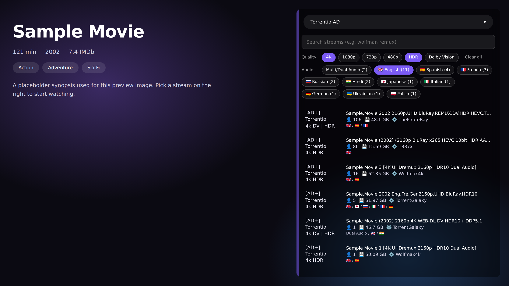
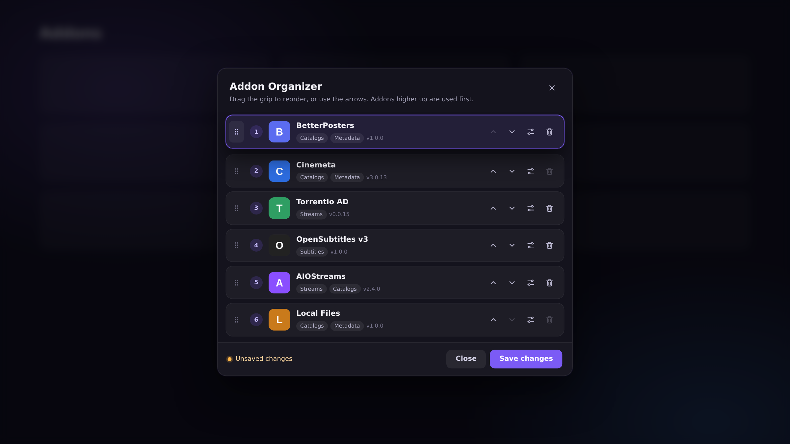
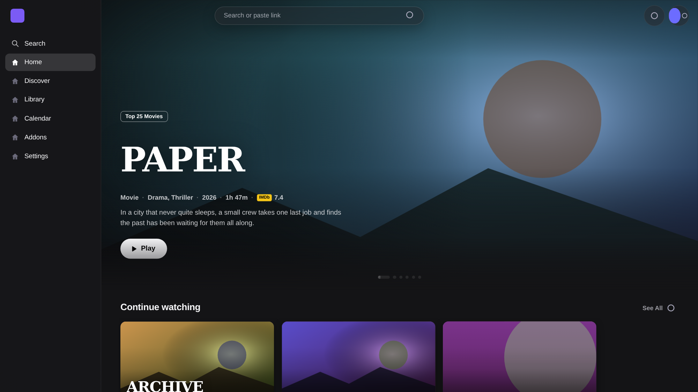
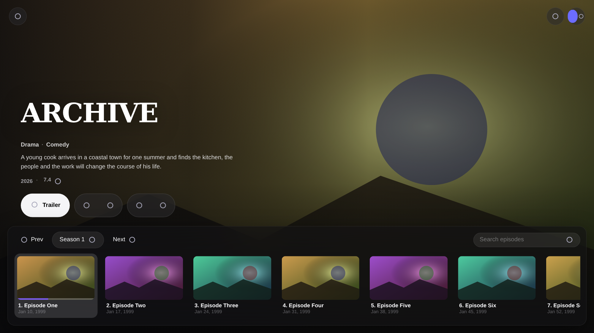

# Echo's Stremio Enhanced Plugins

Three plugins for [Stremio Enhanced](https://github.com/REVENGE977/stremio-enhanced).

| Plugin | Version | What it does | Docs |
| --- | --- | --- | --- |
| **Stream Finder** | 1.0.3 | Search box, quality and audio-language filter chips for the streams list, plus a drag-to-resize streams sidebar | [Full guide](docs/stream-finder.md) |
| **Addon Organizer** | 1.0.2 | Drag-and-drop addon ordering, renaming, and showing or hiding individual catalogs | [Full guide](docs/addon-organizer.md) |
| **Lumen** | 1.1.0 | A cinematic redesign: glass sidebar, rotating hero billboard, landscape Continue Watching, ranked Top rows and TV-style detail pages | [Full guide](docs/lumen.md) |

## Install

1. Download the `.plugin.js` file you want from the [latest release](../../releases), or install it from the plugin browser inside Stremio Enhanced.
2. In Stremio Enhanced go to **Settings → Enhanced → Open Plugins Folder** and drop the file in.
3. Reload (`Cmd/Ctrl + R`) and enable the plugin in Settings.

---

## Stream Finder

- Live search over the stream list (multiple words must all match, `Esc` clears).
- Quality chips: 4K, 1080p, 720p, 480p, HDR, Dolby Vision.
- Audio chips built from the language flags in the list, plus Multi/Dual Audio, with counts.
- Drag the left edge of the streams sidebar to resize it (double-click to reset). Turns itself off in stacked/narrow layouts.

**Network:** none. **Storage:** remembers your sidebar width in `localStorage`.

➡️ [Full Stream Finder guide](docs/stream-finder.md)

## Addon Organizer

- Open it from the **Reorder addons** button on the Addons page.
- Drag the grip or use the arrows to reorder; addons higher up are used first.
- Rename addons and show or hide their individual catalogs.
- Remove addons (built-in ones are protected; removal needs a second click to confirm).

**Network:** talks only to Stremio's own API (`api.strem.io`) using the auth key already stored by Stremio in this app, to read and save your addon collection. It also fetches each addon's own `manifest.json` so hidden catalogs can be restored later. **Storage:** your renames and hidden catalogs in `localStorage`.

Inspired by [Stremio Addon Manager](https://github.com/Zcc09/stremio-addon-manager-plugin) by Zcc09. This is a separate implementation; it can read that plugin's saved settings so you can switch over without losing them.

➡️ [Full Addon Organizer guide](docs/addon-organizer.md)

## Lumen

- Labeled glass sidebar (with Search), frosted floating top bar.
- Rotating hero billboard on Home built from your Trending / Popular / Top rows.
- Landscape Continue Watching cards with backdrops and title logos.
- Big rank numbers on rows whose title starts with "Top".
- Detail pages: full-bleed backdrop, title block bottom-left, streams in a floating glass sheet, episodes as a horizontal strip.
- Options at the top of the file (`CONFIG`): hero on/off, slide count and speed, backdrops, rank numbers.

**Network:** reads public metadata (backdrops, logos, descriptions) from Cinemeta (`v3-cinemeta.strem.io`), the same source Stremio uses. **Storage:** caches that metadata in `localStorage` for 12 hours.

Works alongside Stream Finder and Addon Organizer. Use the **Default** theme with it.

➡️ [Full Lumen guide](docs/lumen.md)

*Preview images use placeholder artwork and titles.*

---

## Notes

- Stremio's class names change between builds, so these plugins match them loosely. If something breaks after a Stremio update, open an issue with a screenshot.
- No tracking, no analytics, no remote code.

## License

MIT, see [LICENSE](LICENSE).
