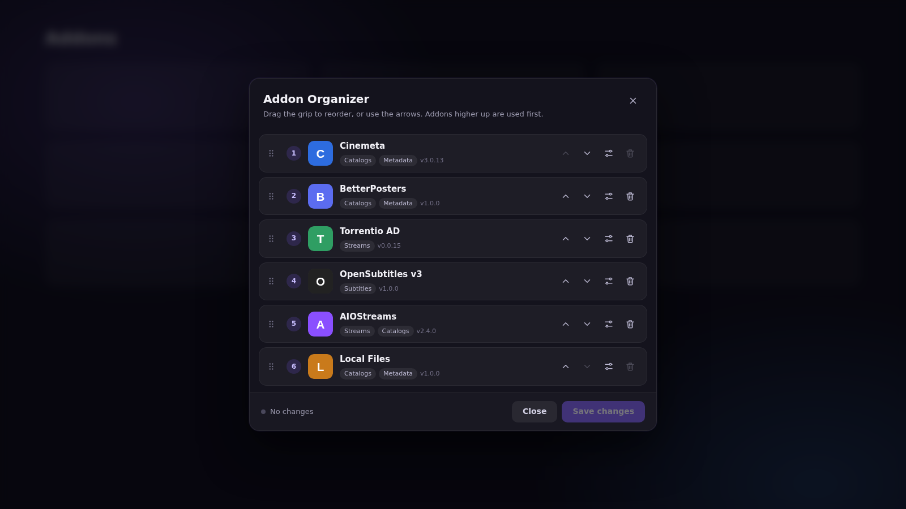
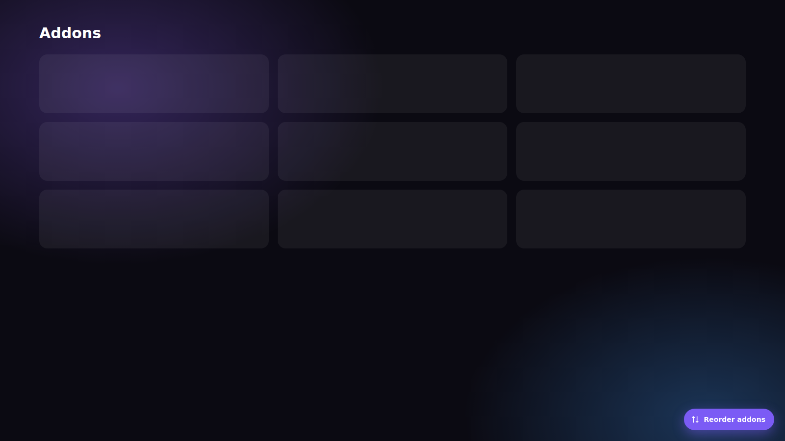
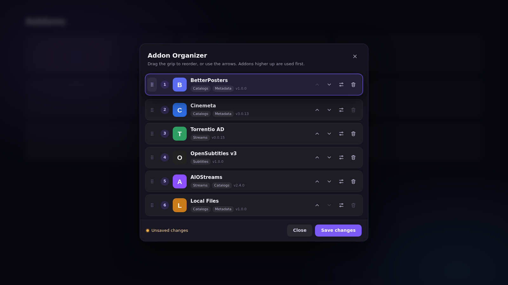
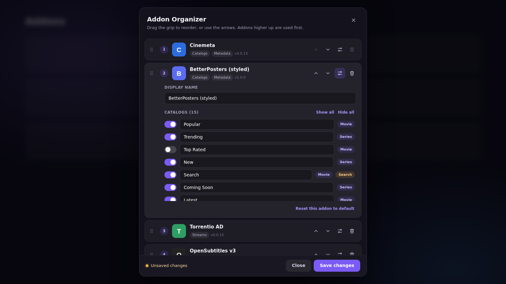
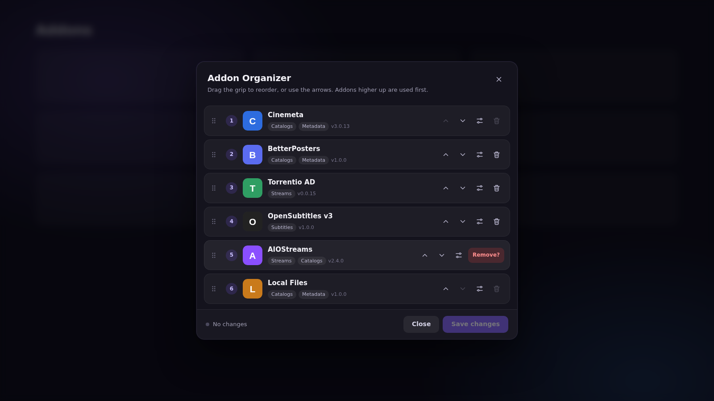

# Addon Organizer

Reorder, rename and tidy your Stremio addons with drag and drop.

**Version:** 1.0.2 · **File:** `addon-organizer.plugin.js` · **License:** MIT

---

## Contents

- [Features](#features)
- [Install](#install)
- [Using it](#using-it)
- [Why addon order matters](#why-addon-order-matters)
- [Privacy, network and storage](#privacy-network-and-storage)
- [Troubleshooting](#troubleshooting)
- [Known limitations](#known-limitations)
- [Changelog and credits](#changelog-and-credits)

---

## Features

- **Drag to reorder** with a grip handle, or use the **up/down arrows** for precise moves.
- Numbered rows, addon logos and tags showing what each addon provides (Catalogs, Streams, Metadata, Subtitles).
- **Rename** any addon.
- **Show or hide individual catalogs**, and rename them. Handy for removing rows you never use from the home page.
- **Remove** addons with a two-click confirmation. Built-in addons are protected.
- Clear **unsaved changes** indicator, and a warning before discarding them.
- Fast: addon details load in parallel.

## Install

1. Download `addon-organizer.plugin.js` from the [latest release](../../../releases), or install it from the plugin browser in Stremio Enhanced.
2. If you downloaded it: **Settings → Enhanced → Open Plugins Folder**, drop the file in.
3. Reload (`Cmd/Ctrl + R`) and enable **Addon Organizer** in Settings.
4. You must be **signed in to a Stremio account**. The plugin edits your account's addon list.

## Using it

### Open it

Go to the **Addons** page and click **Reorder addons** in the bottom-right corner.

### Reorder

- **Drag** the six-dot grip on the left of a row. Other rows slide out of the way.
- Or use the **↑ / ↓** buttons on the right.
- The list scrolls automatically when you drag near its top or bottom.

### Rename and manage catalogs

Click the **sliders** icon on a row:

- **Display name:** type a new name.
- **Catalogs:** each catalog has a switch (on = shown) and an editable name, plus its type. Search catalogs are labeled **Search**.
- **Show all / Hide all** toggle every catalog of that addon.
- **Reset this addon to default** brings back the addon's original name and catalogs.

### Remove an addon

Click the **trash** icon, then **Remove?** to confirm within 3 seconds. Built-in addons (such as Cinemeta) can't be removed.

### Save

Click **Save changes**. Your new order is sent to your Stremio account and the app reloads to apply it. Changes sync to every device signed into the same account.

## Why addon order matters

Stremio asks addons in list order. Order affects:

- **Home page rows:** catalogs from higher addons appear first.
- **Metadata:** when two addons describe the same title, the higher one usually wins.
- **Streams:** results are grouped by addon in this order.

Example: to show BetterPosters' styled rows above Cinemeta's plain ones, drag BetterPosters above Cinemeta.

## Privacy, network and storage

- **Stremio API (`api.strem.io`):** reads and saves your addon collection, using the sign-in key Stremio already stores in this app. Nothing is sent anywhere else.
- **Addon manifests:** fetches each installed addon's own `manifest.json` so hidden catalogs can be restored later.
- **Storage:** your renames and hidden catalogs in `localStorage` (`addon-organizer-config`), so they're re-applied when an addon updates.
- No analytics, no tracking, no remote code.

## Troubleshooting

| Problem | Fix |
| --- | --- |
| "You need to be signed in" | Sign in to Stremio, then reopen the organizer. |
| "Could not read your addon list" | Log out and back in to refresh Stremio's sign-in key, then try again. |
| Save failed | The message shows Stremio's reason. Check your connection and retry. |
| A hidden catalog can't be turned back on | The addon's manifest couldn't be fetched (offline or addon down). Try again later. |
| Order reverted | Make sure you clicked **Save changes** and let the app reload. |

## Known limitations

- Hiding a catalog removes it from your saved addon entry; the plugin restores it from the addon's live manifest when you turn it back on.
- Some addons regenerate their manifest on update, which can bring back catalog names you changed. Your saved settings are re-applied the next time you save.

## Changelog and credits

- **1.0.2**: Public release.
- **1.0.1**: Drag can no longer get stuck if the mouse is released outside the window.
- **1.0.0**: Rebuilt drag-and-drop engine and interface.

Inspired by [Stremio Addon Manager](https://github.com/Zcc09/stremio-addon-manager-plugin) by **Zcc09**. Addon Organizer is a separate implementation; it can read that plugin's saved renames and hidden catalogs, so you can switch without losing them.

---

*Screenshots use placeholder addons and logos.*
