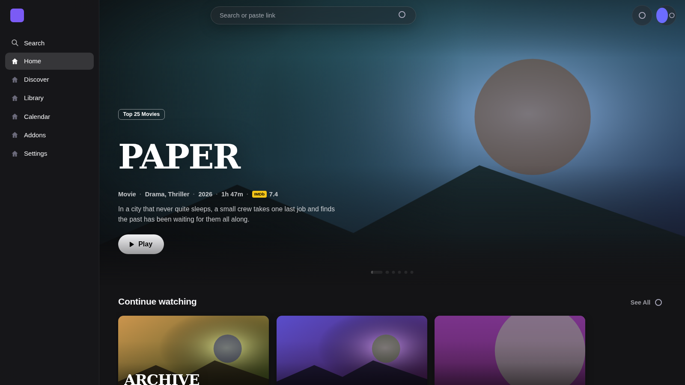
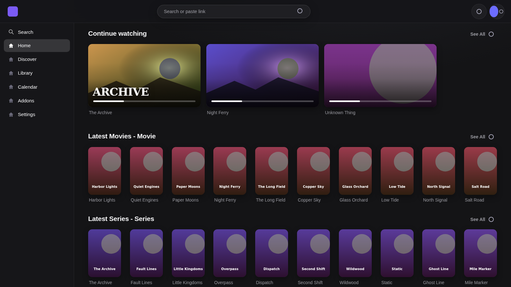
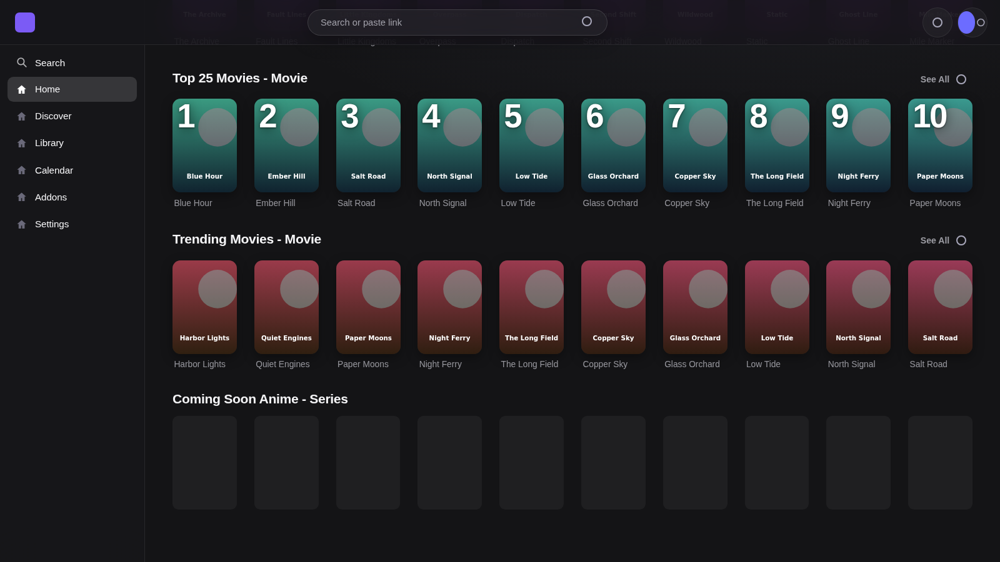
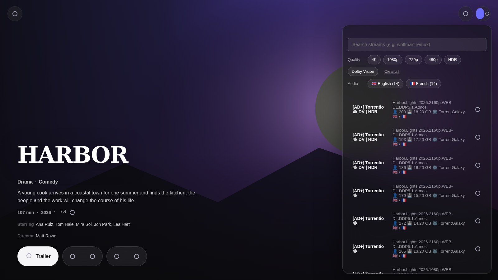
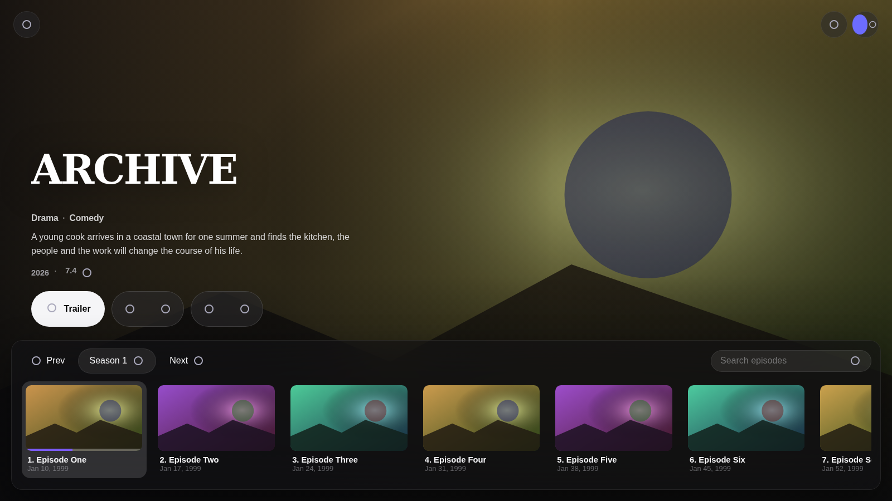
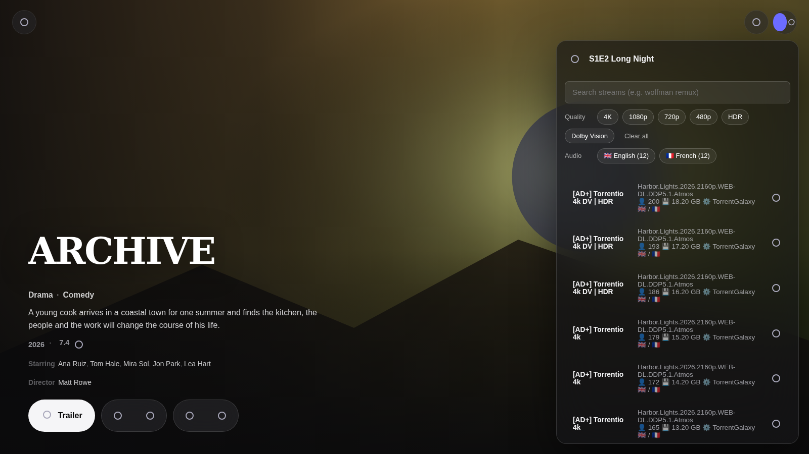
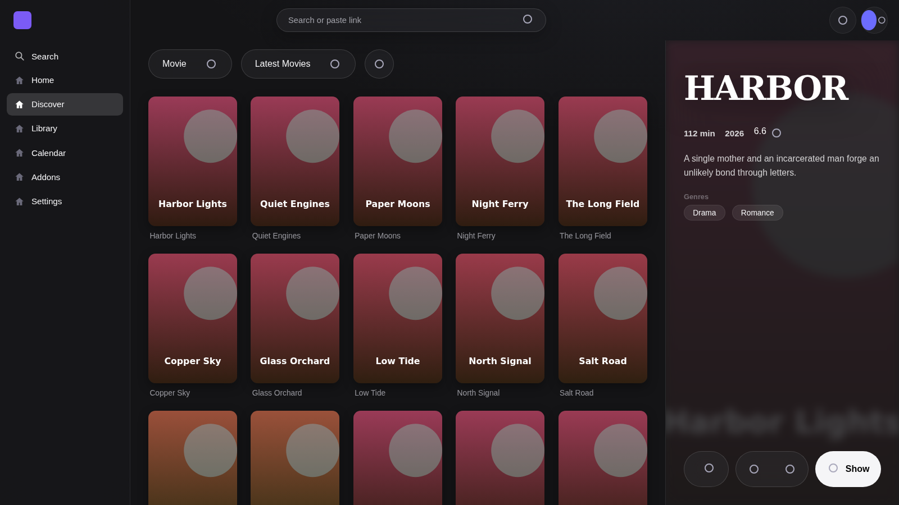
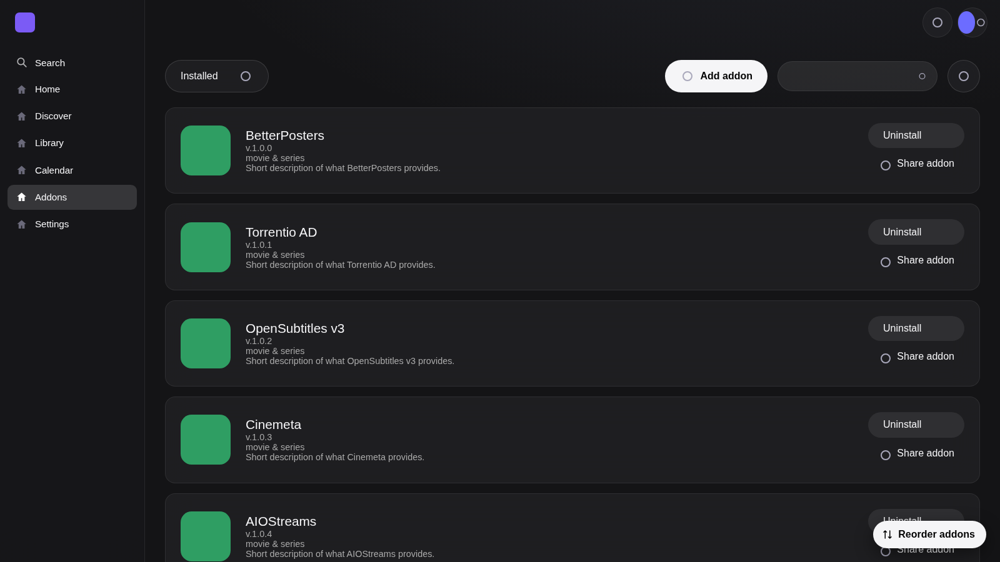
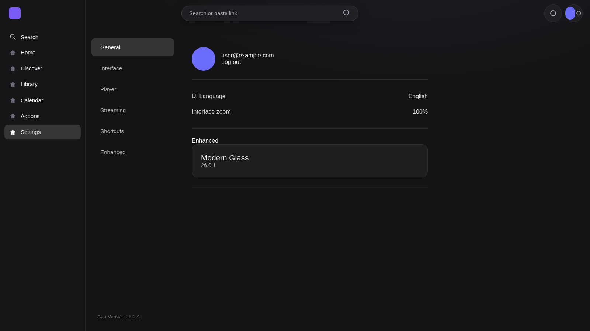
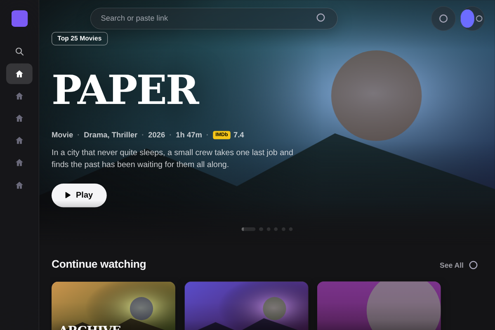

# Lumen

A cinematic, TV-app style redesign for Stremio Enhanced.

**Version:** 1.1.0 · **File:** `lumen.plugin.js` · **License:** MIT

---

## Contents

- [Features](#features)
- [Install](#install)
- [Tour](#tour)
- [Options](#options)
- [Privacy, network and storage](#privacy-network-and-storage)
- [Compatibility](#compatibility)
- [Troubleshooting](#troubleshooting)
- [Known limitations](#known-limitations)
- [Changelog](#changelog)

---

## Features

- **Glass sidebar** with labels (Search, Home, Discover, Library, Calendar, Addons, Settings). Collapses to icons in narrow windows.
- **Floating search pill** that frosts the top bar once you scroll.
- **Hero billboard** on Home, rotating through titles from your Trending, Popular and Top rows, with backdrop, title logo, details and a **Play** button.
- **Landscape Continue Watching** cards with backdrops and title logos, keeping your progress bars.
- **Rank numbers** on any row whose title starts with "Top".
- **Detail pages** rebuilt: full-bleed backdrop, title block bottom-left, people as "Starring / Director" lines, streams in a floating glass sheet, and episodes as a horizontal strip for series.
- Matching glass styling on Discover, Addons and Settings.
- Adapts to short and narrow windows by dropping lower-priority lines instead of squashing them.

## Install

1. Download `lumen.plugin.js` from the [latest release](../../../releases), or install it from the plugin browser in Stremio Enhanced.
2. If you downloaded it: **Settings → Enhanced → Open Plugins Folder**, drop the file in.
3. In **Settings → Enhanced → Themes**, apply the **Default** theme. Other themes restyle the same elements and will clash.
4. Reload (`Cmd/Ctrl + R`) and enable **Lumen**. Look for `[Lumen] v1.1.0 loaded` in the DevTools Console.

## Tour

### Home

The billboard picks up to 6 titles from your home rows and rotates every 9 seconds. Hover to pause; use the arrows or dots to jump. **Play** opens the title's page. If metadata can't be loaded, the billboard simply doesn't appear and the rows start at the top.

### Continue Watching

Wide cards with the title's backdrop and logo. If no backdrop is available, the poster is used instead. Progress bars and the dismiss button still work.

### Ranked rows

Rows whose title starts with "Top" (for example "Top 25 Movies") get large rank numbers.

### Movie page

Backdrop across the whole page, title logo bottom-left, then genres, summary, release info, "Starring" and "Director" lines and the action buttons. The trailer button becomes the main white button. Streams sit in a floating glass panel on the right, and work with [Stream Finder](stream-finder.md) including its resize handle.

### Series page

Episodes run along the bottom as a scrollable strip of wide cards, with the season switcher and episode search in its header.

After you pick an episode, its streams open in the glass panel, with Stremio's back button to return to the episodes.

### Discover, Addons and Settings

### Narrow windows

Below 1000px wide the sidebar shows icons only. On short windows, detail pages hide director and cast lines first, then trim the summary, so nothing overlaps.

## Options

Edit the `CONFIG` block at the top of `lumen.plugin.js`, then reload:

| Option | Default | What it does |
| --- | --- | --- |
| `hero` | `true` | Show the billboard on Home |
| `heroSlides` | `6` | Titles the billboard rotates through |
| `heroInterval` | `9000` | Milliseconds per slide |
| `continueWatchingBackdrops` | `true` | Landscape art for Continue Watching |
| `rankNumbers` | `true` | Rank numbers on "Top" rows |
| `homeLabel` | `"Home"` | Sidebar label used in place of "Board" |

## Privacy, network and storage

- **Cinemeta (`v3-cinemeta.strem.io`):** public metadata (backdrop, logo, description, genres) for the billboard and Continue Watching, looked up by IMDb ID. This is the same metadata source Stremio itself uses. Up to 4 requests run at once.
- **Storage:** that metadata is cached in `localStorage` (`lumen.meta.v1`) for 12 hours (misses for 2 hours), capped at 300 titles.
- No analytics, no tracking, no remote code.

## Compatibility

- Stremio Enhanced 1.x, Stremio web 5.x/6.x layouts.
- Use with the **Default** theme.
- Works with [Stream Finder](stream-finder.md) and [Addon Organizer](addon-organizer.md) (Lumen restyles the organizer's launcher button to match).
- The video player is not modified.

## Troubleshooting

| Problem | Fix |
| --- | --- |
| No billboard on Home | Your home rows need titles with IMDb IDs, and Cinemeta must be reachable. Wait a minute and reload. |
| Layout looks broken | Switch to the **Default** theme and disable other theme plugins that move the sidebar or navigation. |
| Something looks off after a Stremio update | Stremio's class names may have changed. Open an issue with a screenshot and the DevTools Elements panel for that area. |
| Want the old look back | Disable Lumen in Settings and reload. Nothing is changed permanently. |

## Known limitations

- Library, Calendar and the search dropdown use Lumen's general styling only; they haven't had a dedicated redesign yet.
- Titles without IMDb IDs (some anime and custom catalogs) don't appear in the billboard and keep poster art in Continue Watching.
- Stremio's internal class names are matched loosely, so a future Stremio update may need a Lumen update.

## Changelog

- **1.1.0**: TV-style detail pages, episode strip, height-aware layouts.
- **1.0.0**: Glass sidebar, hero billboard, landscape Continue Watching, ranked rows, glass styling across pages.

---

*Screenshots use placeholder titles and artwork.*
