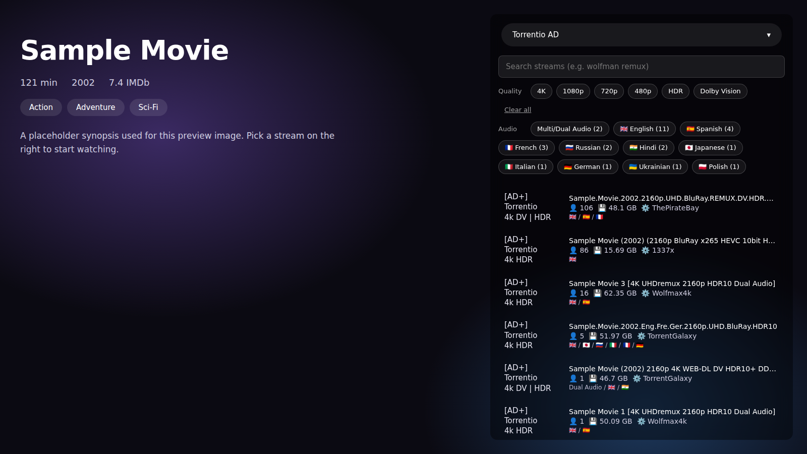
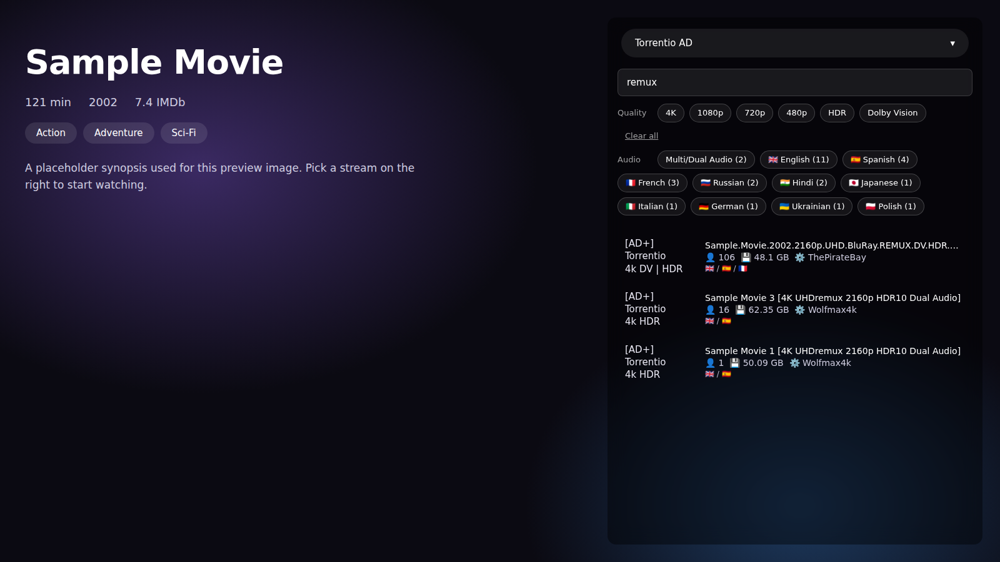
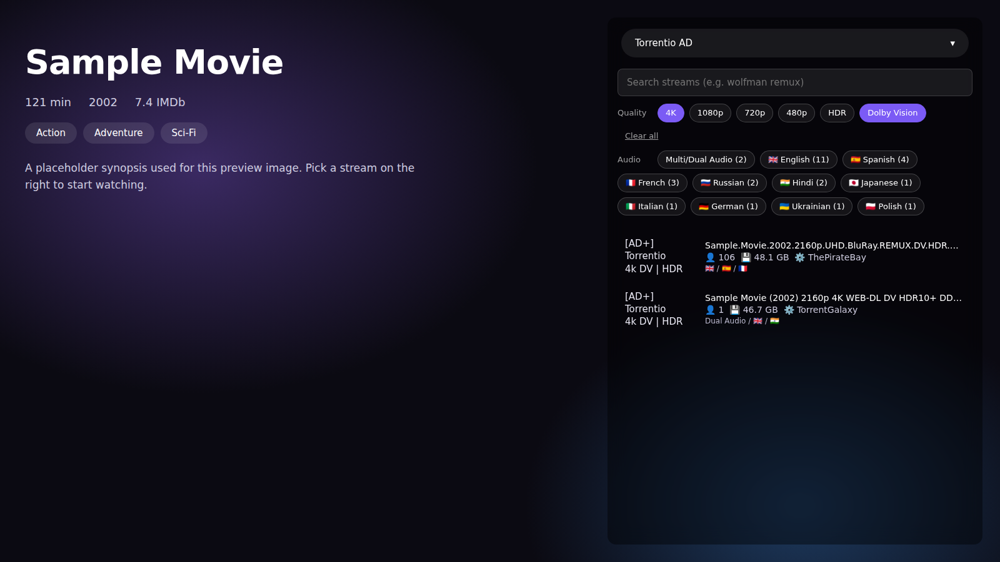
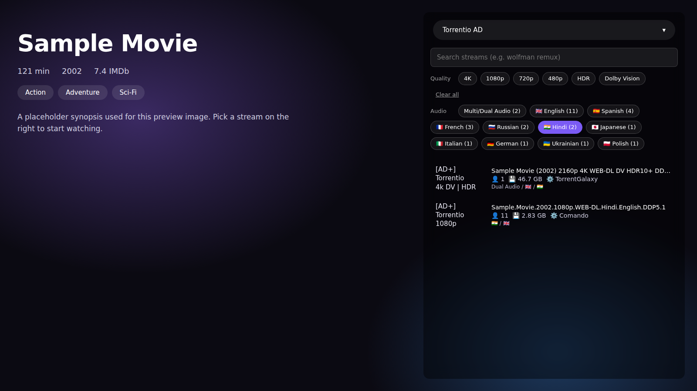
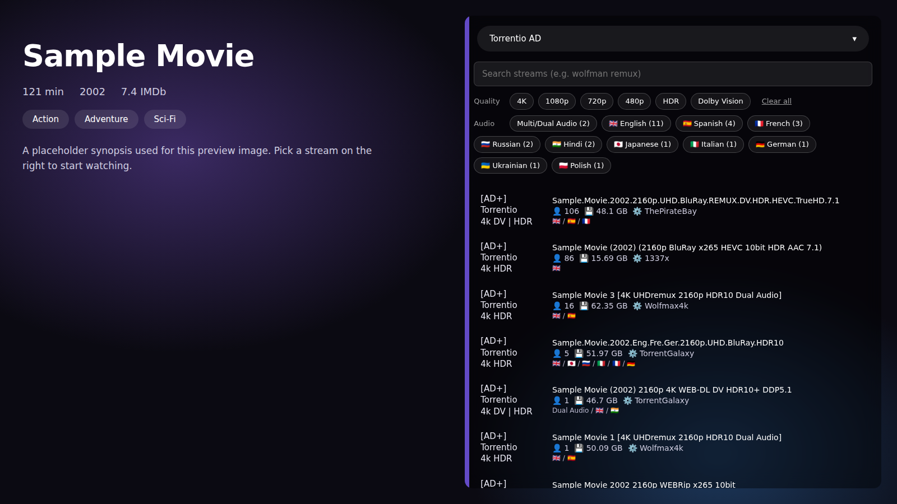

# Stream Finder

Search, filter and resize the streams list in Stremio Enhanced.

**Version:** 1.0.3 · **File:** `stream-finder.plugin.js` · **License:** MIT

---

## Contents

- [Features](#features)
- [Install](#install)
- [Using it](#using-it)
- [How filtering works](#how-filtering-works)
- [Privacy, network and storage](#privacy-network-and-storage)
- [Compatibility](#compatibility)
- [Troubleshooting](#troubleshooting)
- [Known limitations](#known-limitations)
- [Changelog](#changelog)

---

## Features

- **Live search** over every stream in the list, as you type.
- **Quality chips:** 4K, 1080p, 720p, 480p, HDR and Dolby Vision.
- **Audio chips** built automatically from the language flags in the current list, each with a count, plus **Multi/Dual Audio**.
- **Clear all** resets search and chips in one click.
- **Resizable sidebar:** drag the left edge of the streams panel to make it wider or narrower. Your width is remembered.
- Works on movie pages and on series pages after you pick an episode.

## Install

1. Download `stream-finder.plugin.js` from the [latest release](../../../releases), or install it from the plugin browser in Stremio Enhanced (**Settings → Enhanced → Community Plugins & Themes**).
2. If you downloaded it: **Settings → Enhanced → Open Plugins Folder**, drop the file in.
3. Reload with `Cmd + R` (macOS) or `Ctrl + R` (Windows/Linux) and enable **Stream Finder** in Settings.
4. Open any movie. The search box and chips appear above the streams.

To confirm it loaded, open DevTools (`Cmd/Ctrl + Option/Alt + I`) and look for `[Stream Finder] v1.0.3 loaded` in the Console.

## Using it

### Search

Type in the box above the list. Every word must match, in any order, so `4k remux` shows only rows containing both words. Searching covers the release name, quality label, size, seeders, provider and language names (so `hindi` finds rows flagged with 🇮🇳).

- `Esc` clears the search.
- Typing in the box never triggers Stremio's keyboard shortcuts.

### Quality chips

- **4K / 1080p / 720p / 480p** work as *any of*: selecting 4K and 1080p shows both.
- **HDR / Dolby Vision** work as *must have*: selecting both shows only releases that have both.

### Audio chips

One chip per language flag found in the current list, with how many streams have it. Selecting several shows streams with **any** of them. **Multi/Dual Audio** appears when releases are labeled that way.

Everything combines: search text, quality chips and audio chips all apply together. Opening a different title resets the filters.

### Resize the streams sidebar

- Hover the **left edge** of the streams panel until a purple line appears, then drag.
- **Double-click** the edge to reset to Stremio's default width.
- Width is kept between 320px and the window width minus room for the title info.
- In narrow windows, where Stremio stacks the streams under the title, resizing switches itself off and Stremio's own layout is used.

## How filtering works

Stream Finder reads the text Stremio already shows for each stream. It does not call any addon or change what addons return.

| Chip | Matches text like |
| --- | --- |
| 4K | `4k`, `2160p`, `uhd` |
| 1080p / 720p / 480p | `1080p`, `720p`, `480p` |
| HDR | `HDR`, `HDR10` |
| Dolby Vision | `DV`, `Dolby Vision` |
| Multi/Dual Audio | `Multi Audio`, `Dual Audio` |
| Languages | Flag emoji in the row (🇬🇧, 🇮🇳, 🇫🇷 ...) |

Hidden rows are hidden with a CSS class, so other scripts resetting row styles can't undo your filter.

## Privacy, network and storage

- **Network:** none. Stream Finder makes no requests.
- **Storage:** one `localStorage` value, `streamfinder.sidebarWidth`, for your sidebar width.
- No analytics, no tracking, no remote code.

## Compatibility

- Stremio Enhanced 1.x with Stremio web 5.x/6.x layouts.
- Works with Torrentio, AIOStreams and other stream addons, as long as rows contain readable text.
- Works alongside [Addon Organizer](addon-organizer.md) and [Lumen](lumen.md).

## Troubleshooting

| Problem | Fix |
| --- | --- |
| No search box appears | Check it's enabled in Settings, reload, and look for the Console line above. |
| Audio row is empty | The addon isn't putting flag emoji in its stream text. Search by language name instead, or set your addon's formatter to show flags. |
| Resolution chip shows a wrong item | Releases are classified from their text. A 1080p pack whose name mentions "4K" can land under 4K. |
| Sidebar width looks wrong after resizing the window | Double-click the sidebar's left edge to reset. |
| Another filter plugin's controls also show | Both plugins filter the same list. Disable one to avoid confusion. |

## Known limitations

- Language detection depends on flags in the row text; addons that don't show flags won't get language chips.
- Filters reset when you open a different title (by design).

## Changelog

- **1.0.3**: Public release. No longer hides other plugins' controls.
- **1.0.2**: Class-based hiding so filters can't be undone by other scripts.
- **1.0.1**: Resizing turns off in stacked (narrow) layouts. Width is kept within the window.
- **1.0.0**: Search, quality and audio chips, resizable sidebar.

---

*Screenshots use placeholder titles and artwork.*
